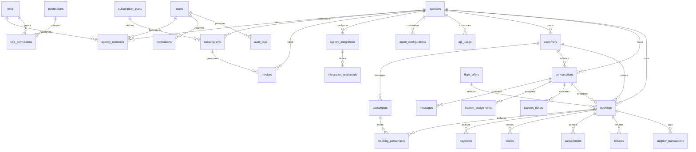

# AI TravelDesk — Database Schema & ERD

## 1. Design Principles

- **Primary Keys**: UUIDv4 (`UUID` native PostgreSQL type) on all tables.
- **Multi-Tenancy**: All agency-owned tables include `agency_id` (`UUID`, indexed, FK to `agencies.id`). PostgreSQL Row-Level Security (RLS) restricts rows to `current_setting('app.current_agency_id', true)::uuid` unless `current_setting('app.is_super_admin', true) = 'true'`.
- **Auditability & Retention**:
  - `created_at` and `updated_at` (`TIMESTAMPTZ`) on every table.
  - `deleted_at` (`TIMESTAMPTZ`, nullable) soft-delete support on core business entities (`users`, `agencies`, `customers`, `passengers`, `bookings`, `support_tickets`).
  - `audit_logs` and `supplier_transactions` are append-only immutable records.
  - Sensitive fields (passport numbers, integration secrets) are encrypted at the application layer before persistence (`_encrypted` columns) and masked in API responses.
  - Retention policy: operational PII (passports) purged/anonymized per agency retention policy after trip completion + statutory window; financial/audit logs retained for compliance (7+ years).

## 2. Entity Relationship Diagram

## 3. Normalized Table Catalog (28 Core Tables + Auth/RBAC Join Tables)

| # | Table | Tenant Scoped | Purpose |
|---|-------|--------------|---------|
| 1 | `users` | Optional (`default_agency_id`) | Platform & agency user accounts, credentials, global platform role |
| 2 | `agencies` | Self (`id`) | Travel agency tenants, status (`PENDING`, `ACTIVE`, `SUSPENDED`), branding & settings |
| 3 | `agency_members` | `agency_id` | Links users to agencies with a specific role |
| 4 | `roles` | Optional (`agency_id`) | System & custom roles (`SUPER_ADMIN`, `AGENCY_OWNER`, `AGENCY_MANAGER`, `TRAVEL_AGENT`, `CUSTOMER`) |
| 5 | `permissions` | Global | Granular RBAC permissions (`bookings:read`, `bookings:write`, `agencies:approve`, etc.) |
| 6 | `subscription_plans` | Global | SaaS tiers (`STARTER`, `PROFESSIONAL`, `BUSINESS`, `ENTERPRISE`) & limits |
| 7 | `subscriptions` | `agency_id` | Active agency SaaS subscription, billing cycle, usage counters |
| 8 | `agency_integrations` | `agency_id` | Configured widget/API/flight/payment integrations per agency |
| 9 | `integration_credentials` | `agency_id` | Encrypted supplier/gateway secrets & API key hashes |
| 10 | `customers` | `agency_id` | Agency-scoped end travelers |
| 11 | `passengers` | `agency_id` | Traveler profiles with encrypted passport/DOB PII |
| 12 | `conversations` | `agency_id` | AI & human support sessions, LangGraph thread state, handoff status |
| 13 | `messages` | `agency_id` | Ordered conversation messages (customer, AI agent, human agent, tool events) |
| 14 | `flight_offers` | `agency_id` | Cached/revalidated supplier flight offers with expiry timestamps |
| 15 | `bookings` | `agency_id` | State-driven flight bookings, PNR, pricing breakdown, idempotency key |
| 16 | `booking_passengers` | `agency_id` | Join table linking bookings and snapshot passenger records |
| 17 | `payments` | `agency_id` | Customer flight payment transactions, gateway refs, idempotency keys |
| 18 | `invoices` | `agency_id` | SaaS subscription & usage invoices for agencies |
| 19 | `tickets` | `agency_id` | Issued e-ticket numbers, segments, supplier confirmation metadata |
| 20 | `refunds` | `agency_id` | Refund calculations, gateway/supplier references, status |
| 21 | `cancellations` | `agency_id` | Cancellation requests, penalty breakdown, approval state |
| 22 | `notifications` | `agency_id` (nullable) | Multi-channel notification log (Email, SMS, WhatsApp, Push, In-App) |
| 23 | `audit_logs` | `agency_id` (nullable) | Immutable security & state-transition audit trail |
| 24 | `agent_configurations` | `agency_id` | Per-agency AI persona, welcome message, languages, service markup rules |
| 25 | `api_usage` | `agency_id` | Metered API & AI token/conversation usage records |
| 26 | `supplier_transactions` | `agency_id` | Immutable request/response log for external GDS/NDC supplier calls |
| 27 | `human_assignments` | `agency_id` | Assignment of conversations/bookings to human travel agents |
| 28 | `support_tickets` | `agency_id` | Escalated customer support cases and SLA tracking |

Supporting normalized tables:
- `role_permissions`: Maps `roles` to `permissions`.
- `refresh_tokens`: Tracks hashed JWT refresh tokens, token family IDs, expiration, and revocation for rotation security.
